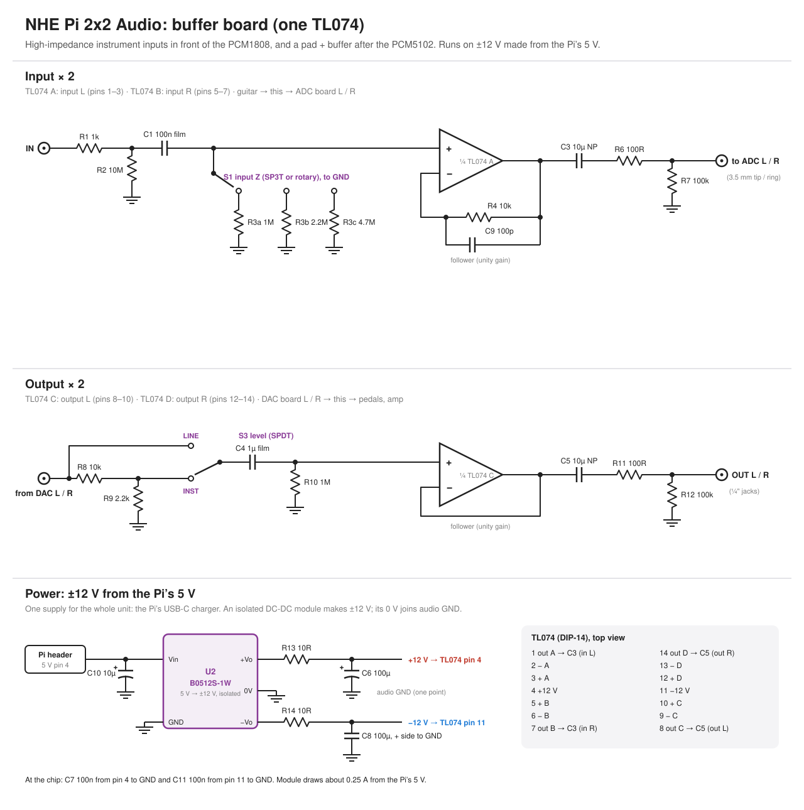
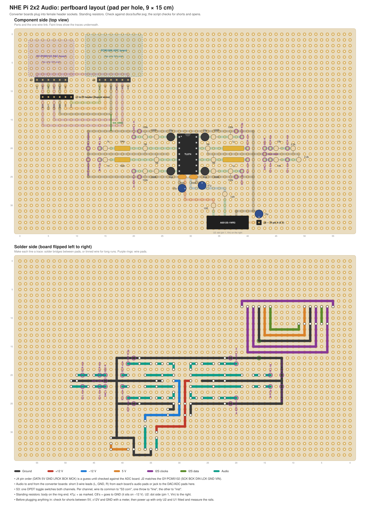

# NHE Pi 2x2 Audio: PCM1808 in, PCM5102A out

Stereo in and out on a Raspberry Pi's I2S pins, with a PCM1808 ADC board
(the clock master: its own 12.288 MHz crystal, 48 kHz) and a GY-PCM5102 DAC
board following the same clocks. Same wiring and files on a Pi 5 and a
Pi 3B+.

## Wiring


| Signal       | ADC (PCM1808) | Pi header          | DAC (GY-PCM5102)        |
|--------------|---------------|--------------------|-------------------------|
| Bit clock    | BCK (out)     | pin 12, GPIO 18    | BCK                     |
| Word clock   | LRCK (out)    | pin 35, GPIO 19    | LCK                     |
| Audio in     | DATA (out)    | pin 38, GPIO 20    |                         |
| Audio out    |               | pin 40, GPIO 21    | DIN                     |
| Master clock | MCK (out)     |                    | SCK (or SCK to GND)     |
| Ground       | GND           | pin 6 / 9 / 14     | GND                     |
| Power        | 5 V from the Pi: its 5 V pin, or its USB-C from a Pi USB port (the analog side needs 5 V; 3.3 V alone won't do) | | VIN to pin 2 or 4 (5 V) |

- **DAC jumpers** on the back: 1 = L, 2 = L, 3 = H, 4 = L (3 is XSMT: on L the DAC stays silent). Leave the SCK jumper open if MCK feeds SCK.
- **Short clock wires** (BCK is ~3 MHz): under ~10 cm.
- **Levels:** the ADC takes line level (3 Vp-p, ~1 V RMS); a guitar needs a buffer in front. The DAC puts out ~2 V RMS: a line output.
- **48 kHz only** (the ADC's crystal): run JACK at 48000.

## Buffer board (guitar in, pedal-level out)



One TL074 between the jacks and the two audio boards, each section a unity-gain follower:

- **Inputs (TL074 A and B):** a buffer for a guitar, in front of the ADC board.
  1 MΩ input impedance (R2), the same as a MOD Duo. Unity gain: the ADC
  clips at 3 Vp-p, which leaves a single coil 4-10 dB of headroom. Add gain in
  software (a gain plugin) if you want it; the PCM1808's ~99 dB of range has room.
- **Outputs (TL074 C and D):** after the DAC board. **S3 INST** pads its ~2 V RMS
  line level down by 15 dB to about 0.38 V RMS, a hot-guitar level for pedals and amps;
  **LINE** passes it straight through, buffered. S3 is one DPDT toggle for both channels.
- **Power: one supply for the whole unit, the Pi's USB-C charger.** An isolated
  DC-DC module (U2, A0512S-1WR3: 5 V in, ±12 V out) runs from the Pi's 5 V (header
  pin 4). A split supply puts the signal at 0 V with about ±10 V of swing, so there's
  no bias divider, and LINE mode takes the DAC's full ~6 Vp-p. The module draws about
  0.25 A from the 5 V. Its 0 V and GND pins both join the board's ground.
  R13/R14 with C6/C8 filter the module's switching noise; it's unregulated, so with
  the TL074's light load the rails may sit nearer ±13-14 V (fine: the TL074 takes ±18 V).
  Keep C6/C8 at 47 µF: these modules can fail to start into much more capacitance.
  Note the name: the A0512S is ±12 V; a **B0512S** is a single 12 V output.

| Part | Each | For |
|---|---|---|
| TL074 (DIP-14) + socket | 1 | U1 |
| A0512S-1WR3 (5 V in, ±12 V out, 1 W, isolated, SIP) | 1 | U2 |
| 1k / 1M | 2 / 2 | R1; R2 |
| 100R / 100k | 4 / 4 | R6, R11; R7, R12 |
| 10k / 2.2k / 1M | 2 / 2 / 2 | R8; R9; R10 |
| 10R | 2 | R13, R14 (rail filters) |
| 100n film (5 mm) / 1µ film (7.5 mm) | 2 / 2 | C1; C4 |
| 10µ non-polar electrolytic | 4 | C3, C5 |
| 47µ electrolytic, 25 V | 2 | C6 (+12 V), C8 (−12 V, + side to GND) |
| 10µ electrolytic, 16 V | 1 | C10, at the module's input |
| 100n ceramic | 2 | C7 (pin 4 to GND), C11 (pin 11 to GND), at the chip |
| DPDT toggle | 1 | S3 |
| ¼" jacks | 4 | IN L/R, OUT L/R |

Values are a starting point, not yet measured on hardware.

## Perfboard layout (everything on one board)



The buffer, the power module and both converter boards on one 9 x 15 cm
pad-per-hole board. The converter boards plug into female header sockets, so
they can come off. `docs/perfboard.py` draws it and checks it: no two nets share
a hole, and every net is connected.

- **Sockets:** J2 takes the GY-PCM5102 (SCK BCK DIN LCK GND VIN). J4's order for
  the PCM1808 board (DATA 5V GND LRCK BCK MCK) is a guess: check it against your
  board before soldering the J4 traces.
- **To the Pi:** J1 (6 pins, Dupont wires): BCK → pin 12, DOUT → pin 40, LRCK → pin 35,
  GND → pin 6, 5V → pin 2, DIN → pin 38. J6: 5 V for the power module → pin 4.
- **Audio leads:** short 3-wire leads (L, GND, R) from the boards' audio pads or jacks
  to the DAC and ADC pads.
- **One wire link** on the component side joins the digital ground to the audio ground.
- **Build order:** traces, then U2 and the TL074 socket (no chip). Power it from the Pi
  and measure about ±12 V on the socket's pins 4 and 11. Then the rest, then the chip.

## Build and install (on the Pi)

```sh
sudo apt install device-tree-compiler
sudo apt install linux-headers-$(uname -r)      # if not found: raspberrypi-kernel-headers
make
sudo make install
```

Then in `/boot/firmware/config.txt` (older images: `/boot/config.txt`), add:

```
dtoverlay=nhe-i2s-duplex
```

(remove `dtoverlay=hifiberry-dac` if you tried the DAC on its own first), and `sudo reboot`.

After a kernel update: `make` and `sudo make install` again (a module is built for one kernel).

## Check it

```sh
aplay -l          # a card "nhe-duplex"
arecord -l        # the same card
speaker-test -D plughw:CARD=nheduplex -c 2 -r 48000 -t sine -f 440
arecord -D plughw:CARD=nheduplex -f S32_LE -r 48000 -c 2 -d 5 test.wav && aplay -D plughw:CARD=nheduplex test.wav
```

(`aplay -l` shows the card's id if it differs from `nheduplex`.) Then pick it
in `sudo patchbox` → JACK: 48000 Hz.

If nothing shows: `dmesg | grep -i -E "nhe|asoc|i2s"`.

## What the files are

- `nhe-i2s-duplex-overlay.dts`: the overlay. The Pi's I2S receives the
  clocks (`i2s_clk_consumer`: the RP1's second I2S block on a Pi 5, the
  BCM2835's I2S on a Pi 3), 2 x 32-bit slots (BCK = 64 fs). Based on the
  kernel's `i2s-master-dac` overlay, which is playback only.
- `nhe-i2s-codec.c`: a stand-in codec. Neither chip has a control bus, so
  there's nothing to drive: it tells ALSA the bus carries stereo in and out,
  16/24/32-bit, 48 kHz. The kernel's own stand-ins are one-way
  (`linux,spdif-dit`, `linux,spdif-dir`) or 16-bit (`asahi-kasei,ak4554`).

## Checked so far (not yet on hardware)

- The overlay compiles and applies to the Pi 5 (`bcm2712-rpi-5-b`) and Pi 3B+
  (`bcm2710-rpi-3-b-plus`) device trees from the Raspberry Pi kernel
  (6.18, Nov 2026): the sound card takes its clocks from the codec, the
  Pi 5's consumer I2S (`i2s@a4000`) is switched on, on GPIO 18-21.
  (Checked with `fdtoverlay`, which can't read the `card-name` option or a
  label on an `__overlay__`; the Pi firmware can.)
- The module compiles for the Pi 5 kernel config (`bcm2712_defconfig`), no
  warnings at `W=1`.
- An old Pi 3 kernel (Patchbox's 2022 image) may not know `i2s_clk_consumer`:
  if `dtoverlay=nhe-i2s-duplex` fails there, replace it with `i2s` in the
  overlay (three places) and rebuild.

## Licence

GPL-2.0 (the kernel module and overlay are built against the Linux kernel). © 2026 New Horizon Electronics.
